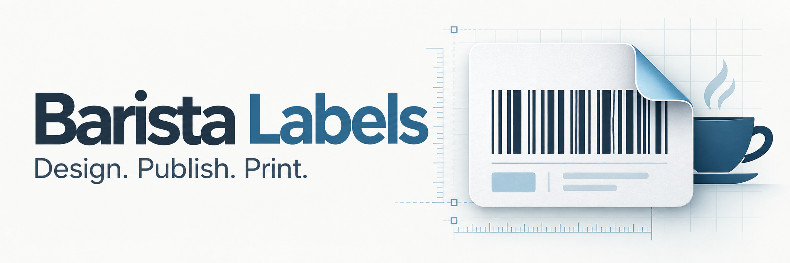

# Barista Labels



Standalone Node.js label designer with a familiar desktop workspace, React/Vite/DaisyUI frontend, portable projects, Microsoft Entra authentication, and Zebra ZPL generation/network printing.

## Branding


The blue folded-label mark is used in the Editor and Printer headers and on the sign-in screen. Reusable assets live in [public/branding](public/branding): the full-resolution banner and transparent icon, plus PNG icons at 16, 32, 64, 180, 192 and 512 pixels. [favicon.ico](public/favicon.ico) contains 16, 32 and 48 pixel icons; the 180 pixel PNG is the Apple touch icon. See [branding notes and generation prompts](docs/branding.md).

## Run locally

Requires Node **24.11+**:

```powershell
npm ci
npm run browser:install
Copy-Item .env.example .env
```

For a local preview, explicitly set `BARISTA_DEV_AUTH=true` in `.env`, run `npm run dev`, and open [localhost:5173](http://localhost:5173). Development authentication requires a loopback server; never expose it through a production proxy. `npm run build` builds the frontend; `npm start` serves the built app and API on port 3001.

The supplied Entra tenant and SPA client IDs are in `.env.example`. Production access stays closed until an API registration, audience and delegated scope are configured. See [deployment](docs/deployment.md).

## Features

- Admin-only Editor and published-label Printer workspaces, with a draft-preserving admin mode switch. See [publishing and printing](docs/published-labels.md).
- Headers-only CSV templates, strict row validation, one label per populated row, and location-filtered printer selection. Printer configuration requires `Labels.Admin`.
- Physical dimensions, rulers/guides, snapping, zoom and pan.
- Text, images, shapes and seven barcode families; numeric properties, multi-selection, alignment/distribution, groups, locking, ordering, clipboard and undo/redo.
- Authoritative local monochrome rendering after edits settle; preview and ZPL share a compilation pipeline.
- Named fields, print-time values and CSV mapping/batch validation.
- Element formulas for automatic text and barcode formatting. See [formula usage](docs/formulas.md).
- Selectable SQLite or SQL Server storage, optimistic revisions/history, local draft recovery and portable `.barista` ZIP files with assets. SQL mode stores asset bytes in the database; see [SSMS setup and migration](docs/sql-storage.md).
- Printer configuration/checks, immutable compilations, quantities, idempotent queueing, cancellation and explicit reprints.
- Dynamic read-only SQL Server printer catalog from `BYAPPS.LabelPrint.dbo.printersZPL`, automatic list refresh and live endpoint validation. See [SQL catalog setup](docs/sql-printer-catalog.md).
- Native boxes/lines only when dot-for-dot equivalence is verified; raster fallback otherwise. No remote rendering services or preloaded printer fonts.

## Compatibility and release gates

This implementation is **not a claim of complete BarTender compatibility**. [BTW research](docs/btw-format.md) states the exact editable support boundary. Thumbnails never count as converted labels. Original files are retained and unresolved essential content blocks printing.

The ZT411 203 dpi preview profile uses 8 dots/mm and an 832 dot maximum width, with no configured endpoint. No physical printer has been contacted. BarTender ZPL comparisons require an installed ZPL driver/queue, absent on the research host; physical acceptance remains pending user testing. See [ZPL validation](docs/zpl-validation.md).

## Checks

```powershell
npm run check
npm run build
npm test
node tools/ui-smoke.mjs
npm run audit:editor-inventory
npm run test:editor-ui
```

Tests cover raster/ZPL reconstruction, barcode/Unicode/geometry validation, malformed BTW envelopes, revisions and portable assets, role boundaries, publication lifecycle, CSV validation, and temporary **local fake printer** delivery. Browser tests use isolated loopback storage and a fake TCP printer; no physical printers are contacted. Restricted environments may need permission for loopback sockets and Chromium processes.

The [editor interaction audit](docs/editor-audit.md) accounts for every interactive editor source site, including conditional dialogs and canvas gestures. Its browser coverage gate rejects unverified or unaccounted-for controls. Run `npm run build` before the browser suites; install Chromium with `npm run browser:install` if needed.

## Research ownership

Application code/assets are independently authored. Research tools inspect installed artifacts or create controlled fixtures. Proprietary labels, binaries, decompiled output, fonts and screenshots are excluded from Git. The app does not load BarTender at runtime. [Editor reference](docs/editor-reference.md) records observed layout and adaptations.
